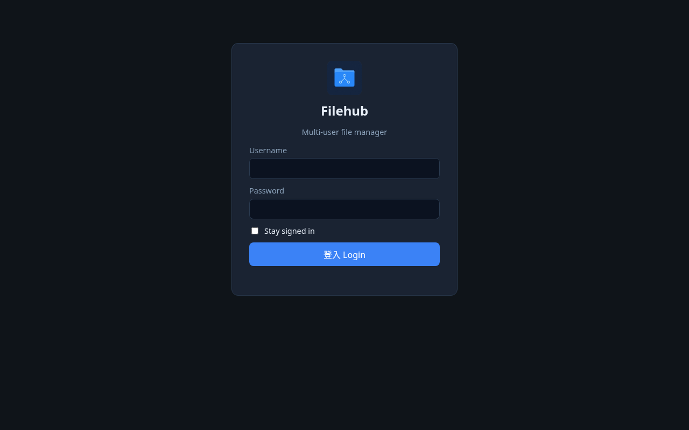
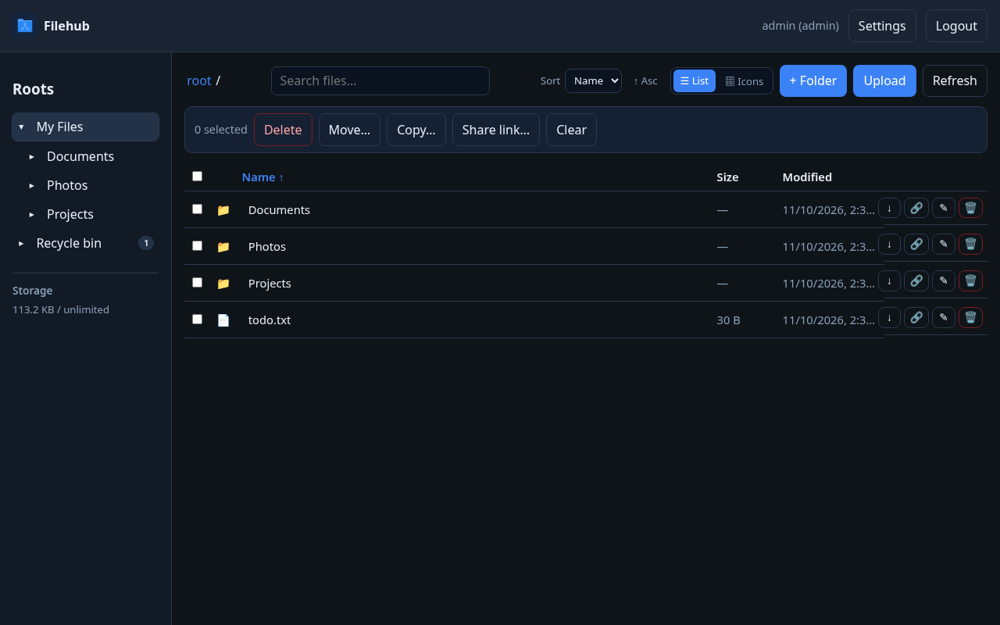

# Filehub v0.4.14

Lightweight multi-user file manager — Go single binary + embedded web UI + SQLite.

**License:** Apache-2.0

## Screenshots





## Where it runs

Filehub is **not** Unraid-only. It runs on any host that can run **Docker** or a **Go binary**:

- Linux VPS / bare metal
- [TrueNAS Community Apps](https://apps.truenas.com/catalog/filehub_community/) (official listing), plus Synology / QNAP / Unraid or any NAS with Docker
- Windows or macOS with Docker Desktop
- Local development via `go run` / a built binary (Linux, Windows, macOS)

Use **Docker Compose** (recommended) or the single binary from Quick start below. The [Hardware thumbnail acceleration](#hardware-thumbnail-acceleration-optional) section is **optional** — it only enables hardware-accelerated ffmpeg thumbnails when a supported device is present. Software ffmpeg works everywhere by default.

## Features

- **Multi-user homes** — each user gets `DATA_ROOT/homes/<username>`; users cannot see each other’s homes
- **Shared folders** — admin-created shares under `DATA_ROOT` with per-user `read` / `write` access and an independent **Allow delete** flag (admin picks a user from a dropdown; existing grants can be changed or revoked)
- **Share with users or a public link** — from a file or folder in the file manager, grant access to one or more Filehub users, create a secret public URL (`/s/<token>`, optional expiry and password), or both. The Share dialog always has a keyword field (username or email). When there are more than five users, the list opens with your five most frequent recipients; type to find anyone else. Recipients with an account see the item under **Shared with me** (read by default; folders can be granted write). Public-link recipients browse/download without an account and can **preview images / PDFs / play videos** inline. In Current access, a long public URL is shown on its own line and truncated; Copy still copies the full address. Revoke a user grant from the Share dialog; revoke public links anytime from Settings → Link shares, or select several and **Delete selected**. Users with an email are notified when SMTP is configured
- **File ops** — browse, **search file and folder names** across My Files and shares you can read, upload files or folders (file picker, **Upload folder**, or drag-and-drop of files and directories, including empty folders; relative structure is preserved; per-file progress in a **bottom-right floating** Uploads panel showing `(done/total)`, hidden until uploads start; large uploads can resume after a dropped connection; if a file with the same name already exists, choose **Skip**, **Overwrite**, or **Rename** — Rename appends `_1`, `_2`, … before the extension, a batch can use **Apply to all**, and Overwrite moves the existing file to the Recycle bin before saving the new one), drag-and-drop into current folder or onto a folder, download, **download a folder as a zip**, mkdir, rename, delete (moves items to a **Recycle bin** instead of immediate permanent delete; while the Recycle bin is open, Folder, Upload, and Upload folder are hidden, and restore / empty actions stay); **multi-select** with bulk Delete / Move / Copy (Move and Copy use a folder picker; writable shared folders are valid destinations); restore or permanently purge from the Recycle bin; list or icons view; **sort** by name / date / type / size (asc or desc, saved in `localStorage`); fixed-column list keeps columns aligned; long names ellipsize; compact action icons
- **Preview** — image, **PDF** (blob-backed iframe; raw endpoints allow same-origin framing), and HTML5 video playback; icon view uses `/api/thumb` for image/video thumbnails; closing the dialog stops video/audio cleanly
- **Thumbnails** — optional ffmpeg thumbs (software by default; hardware acceleration is selected from detected Intel VAAPI, AMD VAAPI, or NVIDIA NVDEC/CUDA devices, with software fallback)
- **App icon** — favicon and Apple touch icon; mark on the login / auth pages and in the top bar after sign-in
- **Settings** — one top-bar entry; left vertical menu, right content panel
  - **Account** — username, home, quota used/limit
  - **Change password** — `POST /api/me/password` (enforces admin password policy)
  - **2FA** — enable/disable TOTP
  - **Link shares** — list, copy, or revoke (permanently delete) public links you created (admins see all); select multiple to delete together
  - **Users / Shares / Session duration / Registration / Security / Email / Storage quota / System** (admins only) — user/share tables; **Session duration** (login lifetime + Stay signed in); **Registration**; **Security** (Force 2FA + password policy); **Email** (SMTP for password reset, pending-registration, shared-folder grants, and user-to-user file/folder shares); **Storage quota** (optional default quota for all users, with per-user overrides under Users → Edit); **System** (DATA_ROOT notes, live CPU / RAM / storage status, and auto-detected GPU / hardware-decode type)
  - **About** (everyone) — project description, GitHub, and Buy Me a Coffee
- **Sidebar** — expandable folder tree under My Files / Shared with me / shares / Recycle bin; a count badge appears to the right of Recycle bin when it has items (`99+` after 99); storage used/limit bar
- **Two-factor authentication (TOTP)** — voluntary per user; admin can require per user or force all (`FORCE_2FA_ALL` / System settings); login second step + forced enrollment; backup codes on enable
- **Password policy** — admin-configurable min length and character classes; enforced on create user, admin reset, self-service change, and forgot-password reset; policy version forces remediation after tighten; login blocks the app until password/2FA requirements are met
- **Forgot password and email notices** — admin configures SMTP; users with an email can request a reset link at `/forgot` (linked from login when ready; rate-limited; generic responses). When SMTP is ready, Filehub also emails administrators (who have an email address) if a new open-registration account is waiting for approval, emails a user when they are granted access to a shared folder or when a file or folder is shared with them (if that user has an email). If SMTP is not configured or the recipient has no email, the original action still succeeds.
- **Open registration** — optional admin toggle; `/register` (linked from login) creates username/email/password accounts under the password policy. New sign-ups require admin approval by default (Settings → Registration and Users). Pending accounts cannot sign in until approved. Rejecting a pending account deletes it so the username can be reused. Already-active users are unchanged. Email notification is optional and is not required.
- **Session duration** — admin sets normal login lifetime (default **7 days**) and may allow **Stay signed in** (default **30 days**); applies to new logins only; existing sessions keep their expiry
- **WebDAV** — mount Filehub as a network drive at `/dav/` with your Filehub username and password (HTTPS). The virtual root lists **My Files**, **Shared with me**, and the shared folders you can access, with the same read / write / delete rules as the web UI. Delete moves items to the Recycle bin. Disabled with `WEBDAV_ENABLED=false`. No anonymous access.
- **Security defaults** — no remote command/shell execution; bcrypt passwords; HttpOnly session cookies; login / reset rate limits; path-traversal guards; container drops to PUID/PGID (default 1000:1000); SMTP password never returned by the API; `X-Frame-Options: DENY` except same-origin framing for `/api/raw`, `/api/thumb`, and public `/raw` preview URLs

Quota counts the user’s **home** directory plus files in shared folders that this Filehub user wrote (upload, copy, or replace). Bytes are attributed to the acting writer; a whole share is never billed to every grantee. Existing share files with no recorded writer stay **unbilled** until a Filehub user writes or replaces them. Recycle-bin items still count toward the owner’s quota until they are permanently purged. Admins can turn on **Apply the same quota to all users** under Settings → Storage quota as the default for users without a custom limit, including new accounts. A different quota can still be set for an individual user under Users → Edit. Settings → System and the Users storage bar use this same definition.

## Quick start

### First boot — admin password (read this)

On **first install**, Filehub creates the seed admin from `ADMIN_USER` / `ADMIN_PASSWORD`. There is **no emailed default password**.

**Docker (recommended):** if you leave `ADMIN_PASSWORD` unset, the container **entrypoint auto-generates** a random `ADMIN_PASSWORD` and `SESSION_SECRET` **once** and writes them to:

| Path inside container | Host path (with default compose `./data:/data`) |
|----------------------|--------------------------------------------------|
| `/data/admin-credentials.txt` | **`./data/admin-credentials.txt`** ← **read this for the password** |
| `/data/.env` | `./data/.env` |

Those files are **never overwritten** on later starts. Open the credentials file, sign in as `admin`, then change the password under **Settings → Change password**.

Optional host helper (project-root `.env` + the same credentials file, also once-only):

```bash
./scripts/gen-env.sh
```

You may still set your own `ADMIN_PASSWORD` / `SESSION_SECRET` in a project `.env` or compose environment before first start; if you do, first boot will use your values (and still write the credentials file once when it is missing).

`ADMIN_PASSWORD` only **seeds** an empty database. Editing env later does **not** change an existing admin hash — use Settings (or recreate the DB during initial setup).

### Docker Compose (recommended)

```bash
mkdir -p data/files data/db
# Optional: ./scripts/gen-env.sh   # writes ./.env + ./data/admin-credentials.txt once
docker compose up -d --build
# Read the generated password (first boot only):
cat ./data/admin-credentials.txt
```

Open <http://127.0.0.1:8088> and sign in as `admin` with the password from `./data/admin-credentials.txt`.  
Compose binds `127.0.0.1:8088` only — put Nginx Proxy Manager (or another reverse proxy) in front.

### Pull a published image

Pre-built `linux/amd64` and `linux/arm64` images are published to [Docker Hub](https://hub.docker.com/r/ericleung001/nas-filehub) (`ericleung001/nas-filehub`) and [GHCR](https://github.com/ericleung001/nas-filehub/pkgs/container/nas-filehub) (`ghcr.io/ericleung001/nas-filehub`). The Debian `ffmpeg` package in the image is multi-arch. Version tags omit the `v` prefix (use `0.4.14`, not `v0.4.14`).

```bash
docker pull ericleung001/nas-filehub:0.4.14
# or
docker pull ghcr.io/ericleung001/nas-filehub:0.4.14
```

`latest` on the default branch tracks the latest build (currently `0.4.14`). To run a published image with the same bind and volume layout as this repo's compose file, set `image: ericleung001/nas-filehub:0.4.14` or `image: ghcr.io/ericleung001/nas-filehub:0.4.14` on the `filehub` service (and drop `build: .` if you do not want to build locally).

### Local development

```bash
./scripts/gen-env.sh   # once — creates ./.env and ./data/admin-credentials.txt
set -a && source .env && set +a
export DATA_ROOT=./data/files DB_PATH=./data/filehub.db THUMB_CACHE_DIR=./data/thumbs LISTEN_ADDR=:8080
go run ./cmd/server
```

Or set `ADMIN_PASSWORD` yourself and run `make run` / `make smoke`.

## Environment variables

| Variable | Default | Description |
|----------|---------|-------------|
| `LISTEN_ADDR` | `:8080` | HTTP listen address |
| `DATA_ROOT` | `/data/files` | File storage root |
| `DB_PATH` | `/data/filehub.db` | SQLite database path |
| `ADMIN_USER` | `admin` | Seed admin **username** on first boot only |
| `ADMIN_PASSWORD` | _(auto on first Docker boot if unset)_ | Seed admin **password** — auto-written once to `./data/admin-credentials.txt` + `./data/.env` when unset; ignored after the admin already exists |
| `SESSION_SECRET` | _(auto on first Docker boot if unset)_ | Auto-generated with the credentials file when unset; also used to encrypt TOTP secrets at rest. If unset at runtime, a key file is written next to the database. Session tokens are random values stored in SQLite |
| `CREDENTIALS_FILE` | `/data/admin-credentials.txt` | Path for the one-time admin credentials file (Docker entrypoint) |
| `DOTENV_FILE` | `/data/.env` | Path for the one-time generated env copy (Docker entrypoint) |
| `SECURE_COOKIES` | `false` | Set `true` behind HTTPS. **Required** (with `PUBLIC_BASE_URL`) for public HTTPS deployments |
| `THUMB_ENABLE` | `true` | Generate thumbs with ffmpeg |
| `THUMB_VAAPI` | `false` | Legacy flag: `true` enables auto hardware thumbnail acceleration when `THUMB_HWACCEL` is unset |
| `THUMB_HWACCEL` | _(empty)_ | `auto`, `off`, `vaapi`, or `nvdec` (`cuda`/`cuvid`/`nvidia` aliases map to nvdec). Empty defers to `THUMB_VAAPI`. Picks the detected render node; always falls back to software ffmpeg, then the original image |
| `PUID` / `PGID` | `1000` / `1000` | Docker only: UID/GID after start, and owner of `/data`. Unset keeps the previous 1000:1000 default |
| `UMASK` | — | Docker only, optional (for example `002`) |
| `THUMB_CACHE_DIR` | `/data/thumbs` | Thumbnail cache directory |
| `LOGIN_RATE_LIMIT` | `10` | Max login and share-link unlock attempts per client IP per minute. Authenticated WebDAV requests are not counted |
| `TRUSTED_PROXIES` | _(loopback only)_ | Extra comma-separated IPs or CIDRs allowed to set `X-Forwarded-For` / `X-Real-IP`. `127.0.0.1` and `::1` are always trusted |
| `LOGIN_LOCKOUT_LIMIT` | `10` | Failed logins per username before that account is temporarily locked |
| `LOGIN_LOCKOUT_MINUTES` | `15` | Account lock window; further attempts during the lock do not extend it |
| `MAX_UPLOAD_MB` | `102400` (100 GiB) | Max upload size in MiB. `0` disables the application cap (user and storage quotas still apply) |
| `FORCE_2FA_ALL` | `false` | If true, every user must enroll TOTP (overrides UI off) |
| `PUBLIC_BASE_URL` | — | Absolute site URL for password-reset emails (e.g. `https://filehub.example.com`). **Required** for public HTTPS deployments so reset links cannot follow a spoofed host |
| `SMTP_ENABLED` | `false` | Env override: enable SMTP |
| `SMTP_HOST` / `SMTP_PORT` / `SMTP_USERNAME` / `SMTP_PASSWORD` / `SMTP_FROM` | — | Env overrides for SMTP (password never logged) |
| `WEBDAV_ENABLED` | `true` | Expose WebDAV at `/dav/`. Set `false` to disable |

## Settings

Sign in → **Settings** (single top-bar button):

1. **Account** (everyone) — username, email, admin badge (if any), home path, storage used / quota
2. **Change password** — requires current password; must meet the admin password policy; other sessions cleared, current kept
3. **2FA** — enable/disable TOTP (Authenticator app + backup codes)
4. **Link shares** — copy or revoke (permanently delete) public file/folder links, or select several and **Delete selected**; deleted rows leave the list
5. **Active sessions** (everyone) — list signed-in devices, revoke one session, or revoke all other sessions. When WebDAV is enabled, Settings → Account also shows the mount URL (`/dav/`)
6. **Users** (admins) — table list of users (home, storage used/quota, status); create / edit / delete; set email / quota (a per-user custom quota overrides the Storage quota default); reset passwords; disable accounts; per-user require 2FA
7. **Shares** (admins) — table list of shared folders (path, grants); create shares; grant access with a user dropdown, Read or Write (write includes read), and **Allow delete**; change or revoke existing grants
8. **Session duration** (admins) — normal session duration and optional Stay signed in (applies to new logins only)
9. **Registration** (admins) — allow open registration; each sign-up email must be unique (including pending and disabled accounts). When admin approval is required, the sign-up page tells the user their account is waiting for approval
10. **Security** (admins) — Force 2FA for all users; password policy (tightening bumps a version so existing users must change password on next login)
11. **Audit log** (admins) — recent sign-in attempts, public link create/revoke, shared-folder permission changes, and user-to-user file or folder shares
12. **Email** (admins) — SMTP for forgot-password, pending-registration notices, shared-folder access notices, and user-to-user file or folder share notices
13. **Storage quota** (admins) — optional default quota for users without a custom limit
14. **System** (admins) — live server CPU, RAM, home-quota totals, `DATA_ROOT` disk usage, and auto-detected GPU / hardware-decode type (Intel VAAPI/QSV, AMD VAAPI, NVIDIA NVDEC, or none), plus `DATA_ROOT` / homes / shares notes
15. **About** (everyone) — what Filehub is, Apache-2.0, [GitHub](https://github.com/ericleung001/nas-filehub), and [Buy Me a Coffee](https://buymeacoffee.com/filehub)

The left sidebar shows the same storage used/limit under Roots, plus an expandable folder tree for My Files and shared roots.

On phones, the file toolbar wraps so Upload/Refresh stay visible, and Settings uses a horizontal scrollable chip nav.

Disabled users cannot log in. Uploads / mkdir that would exceed home quota are rejected.

## Nginx Proxy Manager

1. Keep Filehub on loopback / LAN only (`127.0.0.1:8088`)
2. Add a Proxy Host → your domain → forward to `http://<host>:8088` (or the Docker network hostname)
3. Enable SSL (Let’s Encrypt)
4. Prefer an Access List, Authelia, or Cloudflare Access in front
5. Set `SECURE_COOKIES=true` and `PUBLIC_BASE_URL=https://your.domain` (required for public HTTPS so password-reset emails use a fixed origin)
6. If the reverse proxy is not on loopback, set `TRUSTED_PROXIES` to the proxy’s address or CIDR
7. Set HTTP Strict-Transport-Security on the reverse proxy; Filehub does not enable HSTS itself (LAN HTTP and first-boot must keep working)

**Do not** port-forward the app port directly to the public internet.


## Releases

Tagged releases are published on GitHub: [ericleung001/nas-filehub/releases](https://github.com/ericleung001/nas-filehub/releases).

Each release includes:

- **Changelog** notes for that version
- **Downloadable binaries** for Linux (amd64 and arm64), macOS (amd64 and arm64), and Windows (amd64) when built for that tag
- **Docker** install notes (see Quick start — `docker compose up -d --build` from the tagged source, or pull `ericleung001/nas-filehub` / `ghcr.io/ericleung001/nas-filehub`)

### Install from a release binary

```bash
# example: Linux amd64 from the latest release assets
chmod +x nas-filehub-linux-amd64
# Once: write ./.env + ./data/admin-credentials.txt (or export ADMIN_PASSWORD yourself)
./scripts/gen-env.sh   # from a full clone; or: export ADMIN_USER=admin ADMIN_PASSWORD='your-strong-password'
set -a && source .env && set +a
export DATA_ROOT=./data/files DB_PATH=./data/filehub.db THUMB_CACHE_DIR=./data/thumbs LISTEN_ADDR=:8080
./nas-filehub-linux-amd64
```

Sign in as `admin` with the password from `./data/admin-credentials.txt` (or the one you exported), then change it under **Settings → Change password**. Prefer Docker Compose for production (bind to loopback and put a reverse proxy in front) — first `docker compose up` auto-writes that credentials file when `ADMIN_PASSWORD` is unset.

## Install on TrueNAS (Community Apps)

Filehub is listed in the official [TrueNAS Apps Market](https://apps.truenas.com/catalog/filehub_community/) on the **Community** train. After the initial listing, already-published Filehub versions follow new GitHub releases automatically — you do not need to open a catalog pull request just to bump the version. See the Market page for the version currently offered.

In TrueNAS, open **Apps**, search for **Filehub**, and install it. The install wizard asks for:

- An initial admin username and password (required; these seed the first admin on first boot)
- WebUI port (default **30568**)
- Run-as user and group (default **568**, the TrueNAS `apps` user)

After install, sign in with the admin username and password you set, then change the password under **Settings → Change password**.

Notes:

- Prefer a reverse proxy with HTTPS, then set `SECURE_COOKIES=true` and `PUBLIC_BASE_URL`. **Do not** expose the WebUI port directly to the public internet.
- If the TrueNAS host has an Intel or AMD GPU selected for the app, the catalog enables VAAPI thumbnail acceleration. See also [Hardware thumbnail acceleration](#hardware-thumbnail-acceleration-optional).

## Install on Unraid (Community Apps)

Filehub is available in Unraid Community Applications. Search for **Filehub** and install the template from this repository (`templates/filehub.xml`). The container image is `ghcr.io/ericleung001/nas-filehub` (the `:latest` tag is published from `main`). The template is categorized under Tools › Utilities and Productivity, and includes current login and file-browser screenshots.

First boot:

- Leave `ADMIN_PASSWORD` empty so the entrypoint generates one.
- Open `/mnt/user/appdata/nas-filehub/admin-credentials.txt` (or the appdata path you chose) for the admin password.
- Sign in, then change the password under **Settings → Change password**.

Notes:

- The WebUI listens on container port **8080** (template default host port **8088**). Prefer a reverse proxy with HTTPS, then set `SECURE_COOKIES=true`. **Do not** expose the WebUI port directly to the public internet.
- **Appdata** is mounted at `/data` (database, thumbnails, and `admin-credentials.txt`). User files default to `/data/files` inside appdata unless you set the optional **User files** path.
- **User files** (optional) maps host `/mnt/user/nas-filehub` to container `/data/files` (`DATA_ROOT`) so homes and Filehub-created shares live on a share instead of under appdata. If the container has already been started, move any existing files from `appdata/nas-filehub/files` into the new location before adding this mapping; otherwise the new mount hides the old directory. The entrypoint `chown`s `/data` (including this mount) to `PUID`/`PGID`.
- The optional **Unraid shares** path is mounted at `/data/files/shares` so you can create shared folders with paths such as `shares/Movies` from the Unraid `/mnt/user` tree. Remove that mapping if you do not need host shares. If **User files** is also set, keep **Unraid shares** only when you still want host shares visible under `shares/`.
- Optional Intel VAAPI thumbnails: keep the `/dev/dri` device mapping and set `THUMB_VAAPI=true`. If `/dev/dri` is not present, remove the device mapping and leave `THUMB_VAAPI=false`. See also [Hardware thumbnail acceleration](#hardware-thumbnail-acceleration-optional).
- The GHCR package must be **public** so Unraid can pull `ghcr.io/ericleung001/nas-filehub:latest` without a login.

## Hardware thumbnail acceleration (optional)

This section is **optional hardware acceleration** for thumbnail generation only. Filehub itself does not require a GPU.

Browser playback uses **client** decode. The server may use hardware decode only to speed **ffmpeg thumbnail** generation.

Set `THUMB_HWACCEL=auto` (or the legacy `THUMB_VAAPI=true`, which means the same auto path). Filehub then selects a backend from detected devices:

- Intel or AMD: VAAPI on the matching `/dev/dri/renderD*` node (not hardcoded to `renderD128` when another node is the right one)
- NVIDIA: CUDA/NVDEC (`-hwaccel cuda`). Stock Debian `ffmpeg` in this image usually includes VAAPI but **not** NVIDIA CUDA; if that backend is missing, ffmpeg falls back to software. Do not assume hardware decode works until Settings → System shows a selected hardware path and your ffmpeg build actually supports it.

Leave `THUMB_HWACCEL` empty and `THUMB_VAAPI` unset/`false` to stay on software.

In `docker-compose.yml`, uncomment the device mapping and set:

```yaml
devices:
  - /dev/dri:/dev/dri
environment:
  THUMB_HWACCEL: "auto"
  # THUMB_VAAPI: "true"   # still works; treated as auto when THUMB_HWACCEL is unset
```

NVIDIA hosts also need the NVIDIA Container Toolkit / GPU runtime; this image does not bundle proprietary CUDA ffmpeg. If hardware decode fails, ffmpeg falls back to software; if that fails, the original image is used. Settings → System lists detected GPUs and whether the **current** thumbnail path can use one.

(Full transcode streaming belongs in products like Jellyfin; Filehub stays intentionally light.)

## Security defaults

- No remote command / shell execution surface
- bcrypt password hashes
- Session cookie: `HttpOnly`, `SameSite=Lax`, optional `Secure`
- Login rate limiting
- All file ops confined under the resolved scope root (path traversal protected)
- Container starts as root only to apply `PUID`/`PGID` (default 1000:1000), chown `/data`, then drops privileges with `gosu`

## API summary

Auth / session:

- `POST /api/login` · `POST /api/logout` · `GET /api/me` · `POST /api/me/password` · `GET /api/health`
- `GET /api/me/sessions` · `DELETE /api/me/sessions/{id}` · `POST /api/me/sessions/revoke-others`
- `GET /api/me` includes `usedBytes` (home + attributed share writes + trash) alongside effective `quotaBytes`, `quotaCustom`, `email`, and `status`
- `GET /api/auth/features` (`openRegistration`, `registrationRequireApproval`, `allowRememberMe`, password policy, forgotPassword) · `POST /api/register` (may return `pending`) · `POST /api/forgot-password` · `GET /api/reset-password/meta` · `POST /api/reset-password`
- `POST /api/login` accepts optional `rememberMe` (honored only when admin allows Stay signed in)

Files:

- `GET /api/search?q=` — filename search across My Files and granted shares
- `GET /api/zip?root=&path=` — stream a folder (or file) as a zip (size/time limits apply)
- `GET /api/trash` · `POST /api/trash/restore` · `POST /api/trash/purge` — recycle bin (delete/move-to-trash is `POST /api/delete`; link-share revoke stays a hard-delete of the link row)
- Recycle bin items live under `DATA_ROOT/.filehub-trash/<id>/` (hidden from normal browsing)
- `POST /api/admin/users/:id/approve` · `POST /api/admin/users/:id/reject` (reject deletes a pending account)


- `GET /api/directory` — other active users (id and username only) for the share picker, plus `frequentUserIds` (up to five, by how often the current user has granted them an item share). Optional `q` matches username or email; email is never returned
- `GET|POST /api/item-shares` · `DELETE /api/item-shares/{id}` — user-to-user file or folder grants (recipients appear under the Shared with me root). Posting a user who already has access updates that grant instead of failing.
- `GET /api/roots` (includes `trashCount` for the current user’s visible recycle-bin items, plus Shared with me) · `GET /api/list`
- `POST /api/mkdir` · `POST /api/rename` · `POST /api/delete` · `POST /api/upload` (multipart `file`, `root`, `path`; optional `conflict=skip|overwrite|rename` when the destination name is taken; a collision without `conflict` returns 409; **overwrite** moves the existing file to the Recycle bin first)
- `POST /api/upload/sessions` · `GET|PUT|DELETE /api/upload/sessions/{id}` · `POST /api/upload/sessions/{id}/complete` — chunked, resumable uploads (conflict policy is chosen at init; incomplete sessions expire after 24 hours)
- WebDAV at `/dav/` (Basic auth, same permissions as the UI; `DELETE` moves items to the Recycle bin)
- `GET /api/download` · `GET /api/raw` · `GET /api/thumb`

Admin (requires admin session):

- `GET|POST /api/admin/users` (email on create)
- `PATCH|DELETE /api/admin/users/{id}` (email on patch)
- `POST /api/admin/users/{id}/password`
- `GET|PUT /api/admin/settings` (`force2faAll`, `openRegistration`, `sessionTtlSeconds`, `rememberMeTtlSeconds`, `allowRememberMe`, `globalQuotaEnabled`, `globalQuotaBytes`, password policy, SMTP — password write-only)
- `GET /api/admin/system/status` (CPU, RAM, user quota totals, `DATA_ROOT` disk; admin only)
- `GET /api/admin/audit` (`limit`, `offset`) — append-only audit log (admin only)
- `POST /api/admin/smtp/test`
- `GET|POST /api/admin/shares`
- `DELETE /api/admin/shares/{id}`
- Share grants under `/api/admin/shares/{id}/grants`

## Contributing / release habit

After every intentional change:

1. Update [CHANGELOG.md](CHANGELOG.md) (Keep a Changelog)
2. Commit with a clear English message
3. Push to `origin` `main`

See [CONTRIBUTING.md](CONTRIBUTING.md). Do not commit secrets, deploy env files, binaries, or screenshots.


## Email and forgot password

1. Admin → Settings → **Email**: enable, host, port, username, password, from address. Save. Optionally **Send test email**. The same SMTP settings are used for password-reset mail, pending-registration notices to admins, shared-folder access notices, and user-to-user file or folder share notices to users who have an email address.
2. Set each user’s **email** under Users → Create / Edit (required for that user to receive reset mail).
3. Public HTTPS deployments must set `PUBLIC_BASE_URL` to your public origin (and `SECURE_COOKIES=true`) so reset links cannot follow a spoofed host.
4. The login page links to **Forgot password?** (`/forgot`) when SMTP is ready. The user enters username or email; if a matching account has an email, a one-hour link is sent. The `/reset?token=…` page enforces the current password policy.

SMTP credentials can also be supplied via env (`SMTP_*`); env values override the DB for the running process. The API never returns the SMTP password — only `passwordSet: true|false`.

## WebDAV

WebDAV is enabled by default at `/dav/`. Set `WEBDAV_ENABLED=false` to turn it off.

1. Prefer a reverse proxy with HTTPS. Do not expose the Filehub port directly to the public internet.
2. Mount `https://your-host/dav/` (trailing slash recommended) as a network drive.
3. Sign in with your Filehub username and password. There is no anonymous access. WebDAV uses the account password even if 2FA is required for the web UI.
4. The virtual root lists **My Files**, **Shared with me**, and each shared folder you can access. Read, write, and delete follow the same grants as the web UI. Deleting a file or folder through WebDAV moves it to the Recycle bin. Authenticated WebDAV traffic is not counted toward the login rate limit, so clients such as macOS Finder that send many PROPFIND requests when opening a folder are not blocked with HTTP 429. Failed passwords are still rate-limited.

macOS Finder: Go → Connect to Server → `https://your-host/dav/`. Windows: Map a network drive to that HTTPS URL (the WebClient service must be running). Other clients (rclone, Cyberduck, davfs2) can use the same URL and credentials.

Settings → Account shows the mount URL when WebDAV is enabled.

## Support

Filehub is open source: [ericleung001/nas-filehub](https://github.com/ericleung001/nas-filehub).

If Filehub is useful, you can [buy me a coffee](https://buymeacoffee.com/filehub).

## License

Apache License 2.0 — see [LICENSE](LICENSE).

## Two-factor authentication (2FA)

Uses standard TOTP (RFC 6238, 30s / SHA1 / 6 digits), compatible with Google Authenticator, 1Password, Authy, etc.

1. **User (voluntary)** — Settings → Account → Enable 2FA → scan QR → confirm code. Backup codes are shown once. Disable with password or a current code (blocked if 2FA is required).
2. **Admin per user** — Settings → Users → Edit → **require 2FA**.
3. **Admin all users** — Settings → Security → **Force 2FA for all users**, or set env `FORCE_2FA_ALL=true`.
4. **Login** — after a correct password, if 2FA is enabled the UI asks for a code (or backup code). If 2FA is required but not enrolled, enrollment (QR) is required before a session is issued.
5. **Storage** — TOTP secrets are encrypted at rest with a key derived from `SESSION_SECRET`. Backup codes are stored as bcrypt hashes.

### API — 2FA

| Method | Path | Auth | Description |
|--------|------|------|-------------|
| POST | `/api/login` | — | `{username,password,rememberMe?}`; may return `{needTotp,pendingToken}` or `{needTotpSetup,pendingToken}` (rememberMe survives 2FA) |
| POST | `/api/login/totp` | — | `{pendingToken,code}` → session |
| POST | `/api/login/totp/setup` | — | `{pendingToken}` → `{secret,otpauthUrl,qrDataUrl}` (enroll challenge) |
| POST | `/api/login/totp/enable` | — | `{pendingToken,code}` → session + `{backupCodes}` |
| POST | `/api/me/totp/setup` | session | Start enrollment → QR/secret |
| POST | `/api/me/totp/confirm` | session | `{code}` enable + `{backupCodes}` |
| POST | `/api/me/totp/disable` | session | `{password}` or `{code}` |
| GET | `/api/me/sessions` | session | current user’s sessions (no raw tokens) |
| DELETE | `/api/me/sessions/{id}` | session | revoke one session |
| POST | `/api/me/sessions/revoke-others` | session | revoke all other sessions |
| GET | `/api/admin/audit` | admin | paginated audit log |
| GET/PUT | `/api/admin/settings` | admin | `{force2faAll,openRegistration,sessionTtlSeconds,rememberMeTtlSeconds,allowRememberMe,globalQuotaEnabled,globalQuotaBytes,…}` |
| PATCH | `/api/admin/users/{id}` | admin | accepts `totpRequired` |

SQLite: `users.totp_secret`, `users.totp_enabled`, `users.totp_required`; `settings.force_2fa_all`, `session_ttl_seconds`, `remember_me_ttl_seconds`, `allow_remember_me`; `pending_logins` (includes `remember_me`); `totp_backup_codes`.
